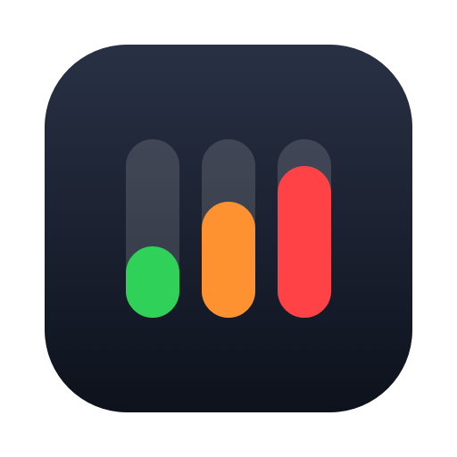

<p align="center"></p>
<h1 align="center">Tidemark</h1>
<p align="center">CPU, RAM, disk and battery meters for your Mac menu bar.<br>One Swift file, no dependencies, about 1% CPU.</p>

## Install

```sh
xcode-select --install   # once; skip if you already have developer tools
git clone https://github.com/niels-bosman/tidemark.git
cd tidemark
./build.sh --install
```

This builds the app, copies it to `/Applications` and opens it. The meters appear in your menu bar; there is no Dock icon.

- **Start at login:** System Settings → General → Login Items → add Tidemark.
- **Quit:** open any meter's menu and choose Quit Tidemark.
- **Uninstall:** quit it, then delete `/Applications/Tidemark.app`.

Developed and tested on one Mac running a recent macOS. Older versions are untested.

## What you get

Each meter is a percentage next to a bar that fills up and changes colour. Click one for details.

| Meter | Bar colour | Click for |
|-------|-----------|-----------|
| **CPU** | green, orange above 60%, red above 85% | Top 8 apps by CPU |
| **RAM** | macOS memory pressure, not % used | Memory breakdown and top 8 apps by memory |
| **SSD** | orange above 80%, red above 92% | Used and available space |
| **BAT** | orange at 20% or below, red at 10% or below | Time left, or time to full, and power draw in watts |

Hover an app in a process list for **Quit** or **Force Quit**. Force Quit only works on your own processes.

## How it works

- **CPU:** busy share of CPU ticks between two samples (`host_statistics`).
- **RAM:** app + wired + compressed memory, as in Activity Monitor. A high number is normal because macOS caches files in spare RAM. The bar colour follows `kern.memorystatus_vm_pressure_level`, which is the real sign of trouble.
- **Disk:** the `/` volume, counting space macOS can reclaim as free.
- **Battery:** IOKit power sources. The time estimate comes from macOS and reflects current draw; watts come from the `AppleSmartBattery` gauge.
- Stats refresh every 3 seconds. Process lists use `ps` and only run while a menu is open.

## Project layout

```
Sources/main.swift       the app
Resources/Info.plist     bundle metadata (menu bar only, no Dock icon)
Resources/AppIcon.icns   app icon
scripts/make-icon.swift  regenerates the icon: swift scripts/make-icon.swift
build.sh                 builds build/Tidemark.app (--install to put it in /Applications)
```

## Limitations

- The app is ad-hoc signed, so it runs on the Mac that built it. Sharing a prebuilt app needs a Developer ID signature.
- No settings, graphs or history.
- The battery meter hides itself on Macs without a battery.

## License

MIT
