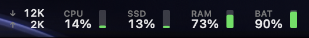
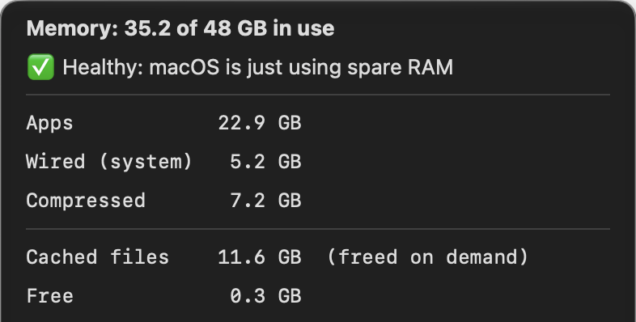
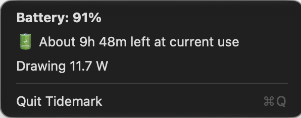

<p align="center"></p>
<h1 align="center">Tidemark</h1>
<p align="center"><b>Your Mac's vitals, always in the menu bar.</b><br>Free and open source.</p>

<p align="center"></p>

Tidemark shows CPU, RAM, disk, battery and network as small live meters in your menu bar. It's a free, open-source alternative to paid menu bar monitor apps: no subscription, no account, no tracking.

- **Tells you when RAM is actually a problem.** The RAM bar follows macOS memory pressure, not "% used", so a Mac that is just using spare memory as a file cache stays green.
- **Light.** One Swift file, no dependencies, about 1% CPU.
- **Act on what you see.** Click CPU or RAM to see the heaviest apps, and quit or force quit them from the menu.
- **Yours to change.** Hide the meters you don't need, start it at login, or read the whole source in a few minutes.

## Install

Needs macOS 13 or later.

**Homebrew** (recommended):

```sh
brew tap niels-bosman/tidemark https://github.com/niels-bosman/tidemark
brew trust niels-bosman/tidemark   # Homebrew 7 and later; skip on older versions
brew install --cask tidemark
```

**Download:** get `Tidemark.zip` from the [latest release](https://github.com/niels-bosman/tidemark/releases/latest), unzip it and move Tidemark to Applications. The app is not notarized, so the first launch is blocked: open System Settings → Privacy & Security and click **Open Anyway**.

**Build from source** (needs the Xcode Command Line Tools):

```sh
xcode-select --install   # once; skip if you already have developer tools
git clone https://github.com/niels-bosman/tidemark.git
cd tidemark
./build.sh --install
```

The meters appear in your menu bar; there is no Dock icon.

- **Start at login:** open any meter's menu → Settings → Launch at Login.
- **Hide a meter:** Settings → untick it. The last visible meter can't be hidden.
- **Quit:** open any meter's menu and choose Quit Tidemark.
- **Uninstall:** quit it, then `brew uninstall --cask tidemark`, or delete `/Applications/Tidemark.app`.

## What you get

Each meter is a percentage next to a bar that fills up and changes colour. Click one for details.

| Meter | Bar colour | Click for |
|-------|-----------|-----------|
| **CPU** | green, orange above 60%, red above 85% | Top 8 apps by CPU |
| **RAM** | macOS memory pressure, not % used | Memory breakdown and top 8 apps by memory |
| **SSD** | orange above 80%, red above 92% | Used and available space |
| **↓ ↑** | no bar, just download and upload speed | Speed in KB/s or MB/s over Wi-Fi and Ethernet |
| **BAT** | orange at 20% or below, red at 10% or below | Time left, or time to full, and power draw in watts |

<p>
  
  
</p>

The CPU and RAM menus also list the top 8 apps. Hover one in a process list for **Quit** or **Force Quit**. Force Quit only works on your own processes.

## How it works

- **CPU:** busy share of CPU ticks between two samples (`host_statistics`).
- **RAM:** app + wired + compressed memory, as in Activity Monitor. A high number is normal because macOS caches files in spare RAM. The bar colour follows `kern.memorystatus_vm_pressure_level`, which is the real sign of trouble.
- **Disk:** the `/` volume, counting space macOS can reclaim as free.
- **Battery:** IOKit power sources. The time estimate comes from macOS and reflects current draw; watts come from the `AppleSmartBattery` gauge.
- **Network:** bytes in and out of the `en*` interfaces (Wi-Fi and Ethernet) between two samples. VPN tunnels are skipped so traffic is not counted twice.
- Stats refresh every 3 seconds. Process lists use `ps` and only run while a menu is open.

## Project layout

```
Sources/main.swift       the app
Resources/Info.plist     bundle metadata (menu bar only, no Dock icon)
Resources/AppIcon.icns   app icon
docs/                    README screenshots
scripts/make-icon.swift  regenerates the icon: swift scripts/make-icon.swift
build.sh                 builds a universal build/Tidemark.app (--install to put it in /Applications)
Casks/tidemark.rb        Homebrew cask, updated automatically on each release
.github/workflows/       release workflow: tag vX.Y.Z to publish
```

## Limitations

- The app is ad-hoc signed, so it runs on the Mac that built it. Sharing a prebuilt app needs a Developer ID signature.
- No settings, graphs or history.
- The battery meter hides itself on Macs without a battery.

## License

MIT
